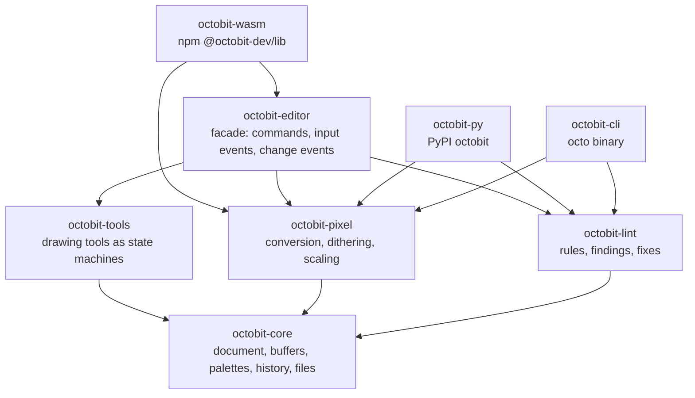
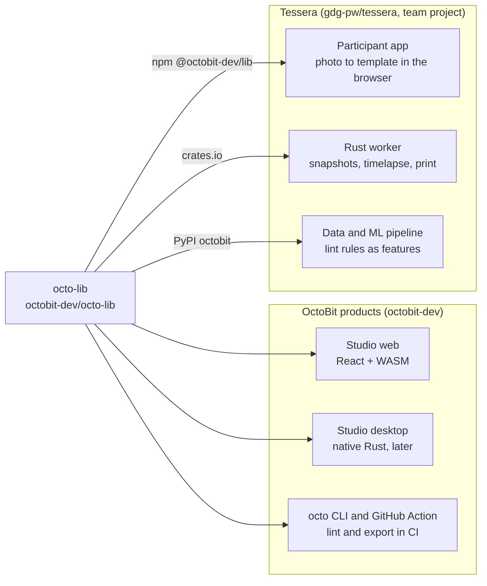

# octo-lib

A deterministic pixel art engine in Rust. One codebase for the browser (WebAssembly), Python, native apps and the command line.

Status: 2026-10-29, before M0. This document replaces the vision document from September 2026. Rules for working in this repository are in [CLAUDE.md](CLAUDE.md).

## What it is

octo-lib holds all pixel art editor logic in one Rust engine:

- the document: layers, frames, cels, palettes and history,
- drawing tools, selections and transforms,
- pixel art algorithms: image to pixel art, dithering, scaling,
- a quality linter with automatic fixes,
- file formats.

Apps that use it are thin shells. They render the engine's state and forward user input. The same logic runs in the browser through WebAssembly, in Python through native bindings, in native Rust apps and in the `octo` command-line tool.

OctoBit Studio, the web editor at [octobit.studio](https://octobit.studio), is the reason the library exists. Studio is written in TypeScript with its own layer engine and `.octo` file format. A desktop app, a live event canvas and asset tooling for games all need the same logic. Written three times in three languages, the versions would drift apart. Written once in Rust, they cannot.

A market survey in September 2026 showed that almost every single feature already exists somewhere: as a small itch.io app, an Aseprite script, a Godot plugin or a GPL-licensed crate. octo-lib differs in form, not in features:

- **One library instead of islands.** One data model, with the indexed image and the palette as first-class objects, available from Rust, npm, Python and a CLI under a permissive license.
- **A linter as an embeddable rule engine.** Existing pixel art linters are standalone apps that only point out problems. `octobit-lint` runs inside an editor, a game engine plugin or CI, and proposes deterministic fixes.
- **No generative AI.** Many pixel art communities and contests ban AI-generated art. octo-lib is fully deterministic and the artist stays in control.

## Principles

1. **The engine owns the logic.** Logic that appears in a UI shell belongs in the engine.
2. **Deterministic.** No generative AI and no hidden randomness. Randomized algorithms take an explicit seed. Native and WebAssembly builds produce identical output.
3. **Indexed first.** Operations respect the palette: they do not invent colors, blur edges or add anti-aliasing nobody asked for.
4. **Single-threaded core.** The web build needs no special headers (COOP/COEP). Parallelism is an optional, native-only feature.
5. **Rewrite the engine, not the product.** The current Studio keeps running until the new engine reaches feature parity.
6. **Users early.** Every milestone puts something in front of real people.
7. **Do not rebuild what works.** Use existing crates, for example for `.aseprite` parsing.
8. **Permissive dependencies only.** No GPL or AGPL, so anyone, including closed-source game studios, can use the library.

## Architecture

Everything rests on `octobit-core`. UI shells talk only to the `octobit-editor` facade, while bindings and the CLI may also call stateless algorithms directly, because a converter or a linter in CI does not need an editor.

UI shells send intents ("select tool", "pointer moved to (x, y)", "undo"). The engine answers with change events ("rectangle R changed on layer L") and exposes read-only state for rendering. On the web, pixel buffers live in WebAssembly memory. The canvas reads them through a view into that memory and redraws only changed rectangles.

History lives in the engine, so undo behaves the same everywhere. Raster operations store pixel patches: the changed rectangle before and after. Structural operations (add, reorder or rename a layer) store a command and its inverse.

## Crates

| Crate | Responsibility |
| --- | --- |
| `octobit-core` | document model, pixel buffers, palettes, color spaces (sRGB, linear RGB, OKLab, OKLCH), selections, compositing, history, snapshots and diffs, file formats |
| `octobit-tools` | drawing tools as state machines: pencil with pixel-perfect mode, eraser, line, rectangle, ellipse, flood fill, selections, transforms |
| `octobit-pixel` | image to pixel art (downscaling, palette generation with k-means in OKLab, palette mapping), dithering (Bayer, Floyd-Steinberg), outline, upscaling for print |
| `octobit-lint` | quality rules that return findings and optional fixes; output as an editor overlay, JSON or SARIF |
| `octobit-editor` | facade for UI shells: commands, input events, change events, state queries |
| `octobit-wasm` | WebAssembly bindings, npm package `@octobit-dev/lib` |
| `octobit-py` | Python bindings (PyO3 + maturin), PyPI package `octobit`, returns NumPy arrays |
| `octobit-cli` | the `octo` binary: lint, convert, export |

Linter rules come in three tiers. Simple rules fix automatically: orphan pixels, doubles on outlines, off-palette colors, unused and near-duplicate colors, stray semi-transparent pixels. Medium rules fix sometimes: irregular jaggies, tile seams. Hard rules only advise: banding, pillow shading. SARIF output shows up as annotations directly in GitHub pull requests.

Files: `.octo` read and write with format versioning and full compatibility with files saved by the TypeScript Studio; `.aseprite` import through an existing crate; export to PNG (including indexed PNG), GIF and sprite sheets with JSON metadata; palettes in Lospec, `.gpl`, `.hex` and `.pal` formats.

## Where it is used

The same engine serves two kinds of consumers: OctoBit products, which use the whole editor, and Tessera, which uses a few stateless pieces through three different channels.

| Consumer | Where | What it uses | Through |
| --- | --- | --- | --- |
| OctoBit Studio, web | octobit.studio | the whole editor, linter, image import | `@octobit-dev/lib` |
| OctoBit Studio, desktop | later | the same, plus native files | crates |
| `octo` CLI and GitHub Action | this repository | lint with SARIF annotations in pull requests, batch conversion, export | binary |
| Tessera | [gdg-pw/tessera](https://github.com/gdg-pw/tessera) | see the next section | npm, crates, PyPI |
| Future projects | not started | palette variants and lint in CI for games, pixel maps, event graphics | crates or npm |

## Tessera

Tessera is a shared r/place-style pixel canvas for events and communities. Participants place pixels from their phones, the canvas grows live on a projector, and every pixel becomes an event for a data and ML pipeline. A six-person university team builds it in 2026/27 as a group project, hosted in the GDG on Campus PW organization. octo-lib is one of its modules.

Rules at the boundary:

- **Tessera belongs to its contributors** and lives in `gdg-pw/tessera`. octo-lib is a dependency, not the owner.
- **octo-lib knows nothing about Tessera.** No event format, Redis, network or Spring code here. That glue lives in the Tessera repository, in its Rust worker.
- **Tessera installs published versions:** npm in the browser, crates.io in the worker, PyPI in the data pipeline. Team members never need a Rust toolchain.
- **The Java backend does not use octo-lib.** It checks colors against the palette itself. No JVM bindings are planned.
- **The browser needs functions, not an editor.** Tessera converts a photo to a template with one call. `@octobit-dev/lib` exposes stateless functions next to the editor facade and must stay small enough for phones on event Wi-Fi.
- **Photos never leave the phone.** Conversion runs in WebAssembly in the participant's browser.

What Tessera needs, with priorities from the team's MoSCoW board (2026-10-29):

| Need | Crate | Channel | Used by | Priority | Needed by |
| --- | --- | --- | --- | --- | --- |
| Canvas palette and color check | core | crates.io | worker | Must | Demo 1, end of stage 1 (Oct-Nov 2026) |
| Indexed canvas buffer | core | crates.io | worker | Must | Demo 1 |
| Snapshots and diffs | core | crates.io | worker | Must | Demo 1 |
| Timelapse: frames from snapshots, GIF export | core | crates.io | worker | Must | Demo 2, end of stage 2 (Dec 2026-Jan 2027) |
| PNG export of the canvas | core | crates.io | worker | Must | Demo 2 |
| Photo to template in the canvas palette: downscaling, palette mapping, optional dithering | pixel | npm | participant app | Should | Demo 2 |
| Python bindings returning NumPy arrays | py | PyPI | data and ML | Should | small-group test, end of stage 3 (Feb-Mar 2027) |
| Lint rules as ML features: orphan pixels, off-palette colors | lint | PyPI | ML | Should | small-group test |
| Print export: integer upscaling, Scale2x as an option | pixel | crates.io | worker | Should | small-group test |

When a Tessera date and an own milestone collide, the Tessera item goes first: five people wait for it.

## Roadmap

There are two tracks. Tessera dates are set by the group project. The own track is defined by scope, not by dates. Rows are in the suggested order.

| Track | Milestone | Scope | Visible result |
| --- | --- | --- | --- |
| Both | M0 | workspace, CI, indexed and RGBA buffers, palettes, OKLab, PNG, golden-image tests | first `octobit-core` release |
| Tessera | T1, end of stage 1 (Oct-Nov 2026) | canvas buffer, palette check, snapshots and diffs | Tessera Demo 1: a pixel from a phone reaches the database |
| Tessera | T2, end of stage 2 (Dec 2026-Jan 2027) | photo to template, first npm release, timelapse, PNG export | Tessera Demo 2 |
| Own | M1 | document, layers, frames, history, compositing, `.octo` compatible with legacy files | opens every existing Studio file |
| Tessera | T3, end of stage 3 (Feb-Mar 2027) | first PyPI release, lint rules for ML features, print upscaling | Tessera small-group test |
| Own | M2 | `octobit-tools` and the `octobit-editor` facade | engine ready for a UI |
| Tessera | T4, stage 4 (Apr-Jun 2027) | fixes and performance | Tessera at the GDG on Campus event |
| Own | M3 | Studio Beta: React UI on the WASM engine, parity checklist against the current Studio | first real users of the engine |
| Own | M4 | full linter with fixes, demo site | public demo |
| Own | M5 | native desktop shell | second platform |

The first npm release moves from M4 in the original vision to T2, and the first PyPI release to T3, because Tessera needs them earlier.

M0 checklist:

- [ ] Cargo workspace (edition 2024) with `octobit-core`; other crates join when they have real code
- [ ] `LICENSE-MIT`, `LICENSE-APACHE`, README and CONTRIBUTING
- [ ] CI on every pull request: format, clippy, tests on native and `wasm32`, license check with cargo-deny
- [ ] Indexed and RGBA buffers, a palette type, sRGB, linear RGB and OKLab conversions
- [ ] PNG read and write, including indexed PNG
- [ ] Golden-image test harness with the first inputs
- [ ] Ruleset on `main`: pull request, green CI, no force push. No required approvals while you work alone, because GitHub does not let authors approve their own pull requests
- [ ] A second owner of the octobit-dev organization, so the organization does not depend on one account

## Distribution and naming

| Where | Name |
| --- | --- |
| GitHub | `octobit-dev/octo-lib`, later `octobit-dev/studio` |
| crates.io | `octobit-core`, `octobit-tools`, `octobit-pixel`, `octobit-lint`, `octobit-editor`, `octobit-wasm`, `octobit-py`, `octobit-cli` |
| npm | `@octobit-dev/lib` |
| PyPI | `octobit` (free in September 2026; check again before the first release) |
| CLI binary | `octo` |
| License | MIT OR Apache-2.0 |

Crates are published only when they contain real functionality. crates.io prohibits name squatting.

## Non-goals

- Generative AI of any kind.
- Autotile generation, normal maps and color ramp generators (crowded market).
- An own `.aseprite` parser.
- Competing with Aseprite as a general-purpose editor.
- Multi-threaded WebAssembly.
- Anything specific to one consumer: event formats, networking, storage.

## Open decisions

1. WASM build tool and package layout: one `@octobit-dev/lib` with everything, or a slim build for Tessera phones.
2. Timelapse output: GIF only, or video as well.
3. Desktop UI toolkit: egui, iced or Slint.
4. Tiled pixel storage for large canvases, only when a consumer needs it.
5. Minimum supported Rust version.
6. Weekly time budget, which sets dates for the own track.
7. Whether a separate OctoBit Live product will ever exist. The live event canvas is now Tessera, owned by its team.
8. Registering the OctoBit trademark before any paid product.

## Decision log

| Date | Decision | Why |
| --- | --- | --- |
| 2026-09-22 | No generative AI | many communities and contests ban it; the artist stays in control |
| 2026-09-22 | GitHub organization `octobit-dev`, crates `octobit-*`, npm scope `@octobit-dev` | `octo-core`, `octo-tools`, `octo-cli` on crates.io and the `@octobit` npm scope are taken |
| 2026-09-28 | Rust core with Python bindings through PyO3 and maturin | the library must be fast; Python users install it with pip, like Polars or pydantic-core |
| 2026-10-24 | Tessera lives in `gdg-pw`, octo-lib stays in `octobit-dev` | the team owns its project; Tessera uses octo-lib like any other library |

## Links

- Organization: [github.com/octobit-dev](https://github.com/octobit-dev)
- OctoBit Studio: [octobit.studio](https://octobit.studio)
- Tessera: [github.com/gdg-pw/tessera](https://github.com/gdg-pw/tessera)